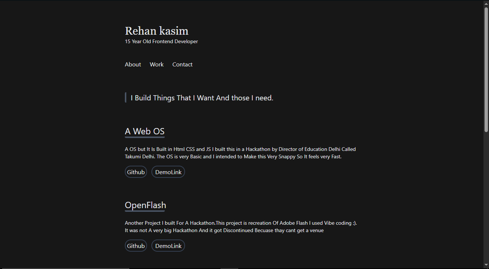

# PortFolio
It is a simple Portfolio i made to learn Tailwind.
## Description
I used to be good at CSS and Tailwind, but then vibe coding got me and i forgot most of it. Now i am relearning it from the start. The hardest part was that i barely remember any CSS, so Tailwind felt very hard again. I like how polished the ui looks. I still need to add more projects and make the ui even better.
### ScreenShots

## Getting Started
### Dependencies
* A modern Browser
* VS Code optional
* Python Optional
### Installing
* Download the Github Repo As Zip
* Or do ```git clone https://github.com/rehan-kasim/portfolio```
### Executing Program
* Download the file and double click it to open in browser
* Or launch a python Local Server
* Or Use live Server Extension In VS Code
### Help
* If you ran Into Any problem Just open a issue
* Or ask Chatgpt, i would do the same
## What's next
* Add more projects
* Fix some stuff in the design
* Learn more Tailwind
## License
This project is licensed under the MIT License - see the LICENSE.md file for details
